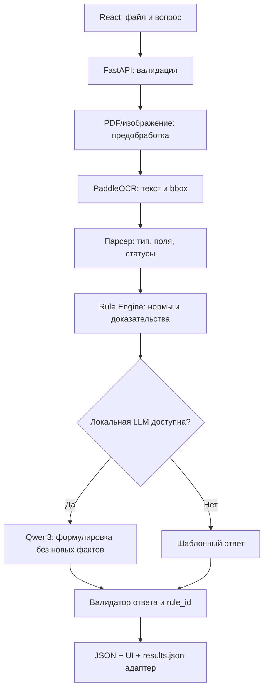

# 🛠️ Архитектура

> [!abstract] Кратко
> Страница рабочей документации проекта «Онлайн-деканат». Исходное содержание сохранено.

## 🗺️ Содержание

- [[#📌 Поток обработки|Поток обработки]]
- [[#🔎 Границы компонентов|Границы компонентов]]
- [[#Предполагаемая структура кодового репозитория|Предполагаемая структура кодового репозитория]]
- [[#Надёжность|Надёжность]]

---


## 📌 Поток обработки


## 🔎 Границы компонентов
- `document_ingest`: MIME, размер, страницы, временные файлы; защита от вредоносных файлов.
- `ocr`: список блоков `{text, bbox, confidence, page}`.
- `extract`: три парсера полей, общая модель `FieldResult`.
- `rules`: версия Положения, список `rule_id`, условия и доказательства; **никаких придуманных условий**.
- `answer`: шаблон по умолчанию, опционально локальная LLM. Ответ не должен ссылаться на неизвестные пункты.
- `export`: преобразование внутреннего формата в **официальный** `results.json`.

## Предполагаемая структура кодового репозитория
```text
project/
  backend/app/{api,ocr,extract,rules,answer,schemas}/
  backend/tests/
  backend/data/{rules,fixtures}/
  frontend/src/{components,pages,api}/
  docker-compose.yml
  README.md
```

## Надёжность
Для каждого решения сохранять `document_id`, `field_status`, `rule_id`, короткое evidence. При сбое OCR/LLM — управляемая ошибка, без ложного «документ подходит». Невозможность проверить печать отмечать `requires_manual_review`.

См. [[02 Техника/Контракт API]] и [[06 Качество/План тестирования]].

## 🔗 Связанные заметки

- [[00 Главная|00 Главная]]
- [[02 Техника/Технологический стек|Технологический стек]]
- [[02 Техника/Контракт API|Контракт API]]
- [[04 Задачи/Главный TODO|Главный TODO]]
- [[05 Календарь/Календарь спринта|Календарь спринта]]
