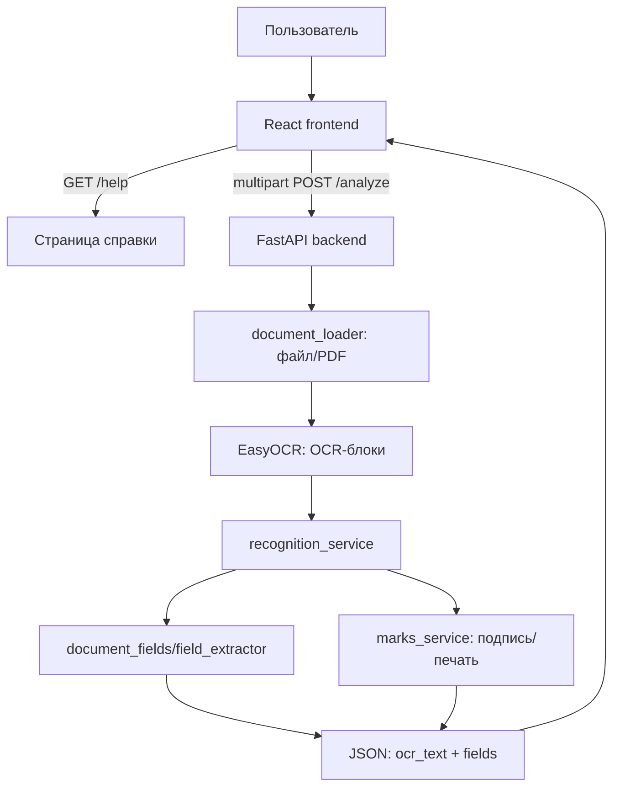

# Архитектура

## Общая схема



## Frontend

Главная страница находится в `frontend/src/pages/DocumentCheckerPage.tsx`.

Слои:

- `components/` — визуальные панели загрузки, найденных полей, результата и вопроса.
- `hooks/` — координация reducer и сервиса.
- `model/` — reducer, состояние, валидация.
- `services/ApiDocumentCheckService.ts` — реальный HTTP-клиент `/analyze`.
- `services/DemoDocumentCheckService.ts` — fallback для локального демо.
- `pages/HelpPage.tsx` — справочная страница `/help`.

Роутинг пока простой: `App.tsx` проверяет `window.location.pathname === "/help"`.

## Backend

Backend расположен отдельно: `backend/online-dekanat-backend`.

Слои:

- `main.py` — FastAPI, ограничения размера, `/health`, `/analyze`.
- `services/document_loader.py` — загрузка изображений и рендер одностраничного PDF.
- `services/ocr_service.py` — создание EasyOCR reader и чтение OCR-блоков.
- `services/recognition_service.py` — общий pipeline.
- `services/field_extractor.py` — обработчик справки об обучении.
- `services/document_fields.py` — схемы полей для трёх типов.
- `services/marks_service.py` — эвристики подписи и печати.

## Поток запроса

1. Пользователь выбирает тип документа и файл.
2. Frontend проверяет формат, размер и наличие вопроса.
3. `ApiDocumentCheckService` формирует `FormData`.
4. Backend проверяет `prompt`, `document_type`, MIME, размер и количество файлов.
5. PDF рендерится в изображение, изображение проходит OCR.
6. OCR-блоки превращаются в текст и поля выбранного типа.
7. Frontend мапит ответ backend в UI-модель `DocumentCheckResult`.

## Надёжность

- Backend не хранит файлы постоянно.
- Ошибки OCR возвращаются как `503`, ошибки формата — `422`, превышение размера — `413`.
- OCR выполняется в рабочем потоке и ограничен одним одновременным распознаванием на процесс.
- При отсутствии поля frontend показывает `Не найдено`, а не придумывает значение.

## Нерешённая архитектурная часть

Нужен слой правил:

```text
fields + ocr_text + document_type + question
  -> rule engine
  -> answer + rule_id + evidence + confidence/manual_review
  -> results.json
```

См. [[02 Техника/Контракт API]].
